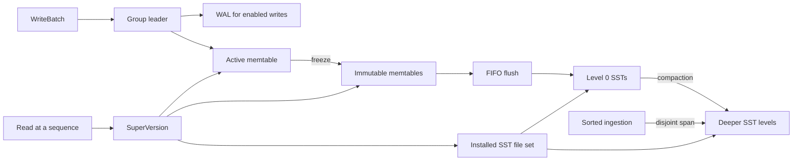

# MMDB v6 storage architecture

MMDB stores byte keys and values in a local directory inside the caller's
process. For the guarantees an application can rely on, see the
[usage guide](usage.md). The chapters below follow each operation from its
Rust entry point to the state it reads or publishes.

## Global system overview

A writable `DB` owns the active memtable, one FIFO flush worker, and one or
more compaction workers. A `SuperVersion` holds references to the active and
frozen memtables and the installed SST file set. `ArcSwap` lets readers
acquire this view without the writer mutex. Looking up a key can still require
cache access and file I/O.

## Data model and internal keys

User keys compare bytewise. Each internal key appends an eight-byte,
big-endian trailer containing `!((sequence << 8) | value_type)`. The
comparator first compares the user-key portions, then compares the trailers
for equal user keys. This places `a` before `aa` at every sequence and orders
versions of `a` newest first. A sequence uses 56 bits. At equal sequences
the type order is `RangeDeletion` (2), `Value` (1), then `Deletion` (0).
[Encoding and comparator](../src/types.rs)

A point deletion names one key. A range deletion covers `[begin, end)` at its
sequence. Memtables and SSTs index range deletions separately from point
entries. A lookup must account for a covering range even when the file
holding it has no point entry near the requested key. [Read path](architecture/reads.md#point-lookups)

## Subsystem map

| Operation | Implementation chapter |
|---|---|
| `DB::write`, `sync_wal`, `flush` | [Write admission, WAL acknowledgement, and durable L0 installation](architecture/writes.md) |
| `DB::ingest_sorted` | [Bottom-level SSTs and atomic publication](architecture/writes.md#sorted-ingestion) |
| `get`, `get_many_pinned`, `iter_with_range`, `snapshot` | [Read views, lookups, scans, and snapshot lifetimes](architecture/reads.md) |
| `compact`, `compact_range`, background compaction | [File selection, snapshot retention, and installation](architecture/compaction.md) |
| `open`, `open_read_only` | [Database files, MANIFEST validation, and WAL replay](architecture/recovery.md) |
| Find a point block or a range deletion | [SST v2 physical layout](architecture/sst-and-cache.md#sst-v2-physical-layout) |
| Observe cache charge or retain a value after close | [Cache ownership and memory gauges](architecture/sst-and-cache.md#cache-ownership) |

## Concurrency, lock hierarchy, and lifecycle

### Lock acquisition order

Group leaders serialize WAL I/O and memtable insertion under `DB::inner`.
Freezing seals the old WAL outside that mutex. Flush and compaction also
build SSTs, prepare readers, and confirm MANIFEST durability outside the
mutex. They install edits under `DB::inner`, which can include I/O for a
MANIFEST rotation. The concurrency checklist traces the lock order through
write barriers, compaction claims, and worker notifications. [Lock hierarchy](ai/patterns/concurrency.md#lock--synchronization-hierarchy)

An SST build registers its thread in `SstBuilds`. A same-DB write, flush,
explicit compaction, WAL fence, or close from a filter, collector, or sorted
input callback returns `InvalidArgument`. This keeps the callback from
waiting for its own operation. [Write and close guards](../src/db.rs) ·
[Ingest callback tests](../src/db/ingest.rs)

### Fail-stop error latching and shutdown

A failed WAL append or sync, a poisoned MANIFEST or directory sync, or a fatal
flush or compaction error stops further reads and writes on the handle. MMDB
publishes the error before waking flush waiters. A failing background or
write-stall compaction also publishes it before releasing claimed files, so
another worker cannot pick those files and install a later edit.
[Failure publication](../src/db.rs) · [MANIFEST durability checks](../src/manifest/version_set.rs)

`DB::close()` marks the handle closed, drains active maintenance and the
write leader, and flushes the final generation on a healthy writable handle.
It joins workers, detaches the cache member, saves the final level properties,
releases its table readers and directory lock, and reports failures. An
implicit `Drop` attempts a WAL sync and cannot report an error. Pins and
already-created iterators can outlive the DB. [Shutdown paths and tests](../src/db.rs)

## Profiling foreground and background work

| Feature and API | What the measurement covers |
|---|---|
| `bench-metrics` · `take_thread_write_profile()` | Drains the calling thread's counters. A group leader records WAL, apply, and freeze stages for the group. Follower wait times can overlap those stages. [Write-stage workloads](benchmarks/engine-profile/README.md) |
| `bench-metrics` · `L0CompactionProfile` | Tracks L0 file counts, logical input bytes, bytes rewritten, and subcompaction concurrency. A trivial move rewrites zero SST bytes. [L0 measurements](benchmarks/l0-profile/README.md) |
| `test-utils` · `DB::simulate_crash()`, `point_table_probes()`, `PinnedSlice::sst_backing_charge()` | Test helpers discard buffered tails for recovery tests or attribute SST probes and retained blocks. Under Miri, `concurrent_arena_pins()` exercises memtable pin lifetimes. [Public exports](../src/lib.rs) · [Grouped-read trials](benchmarks/grouped-reads/README.md) |
