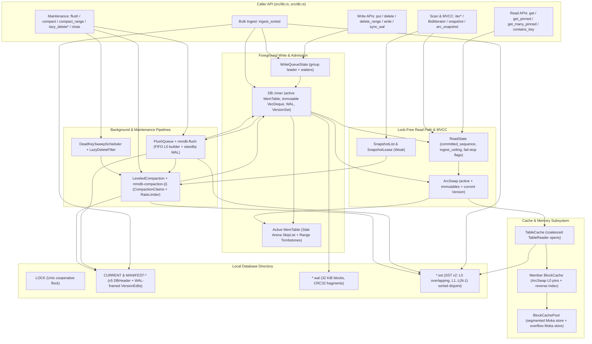
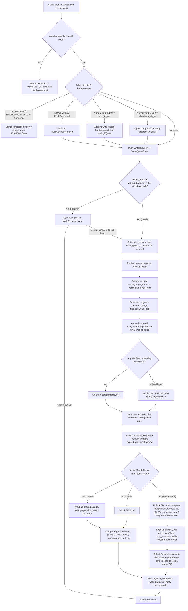
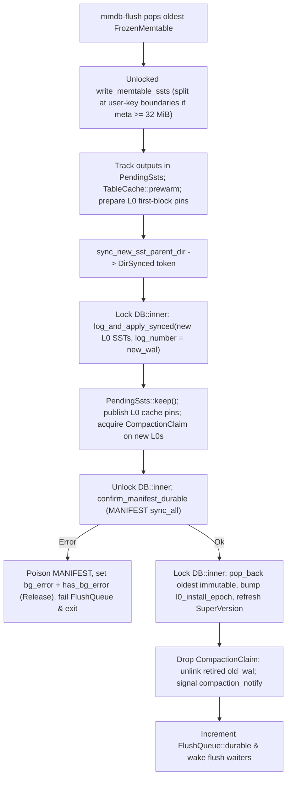
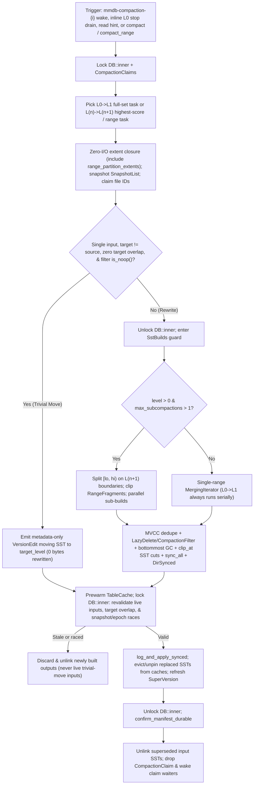
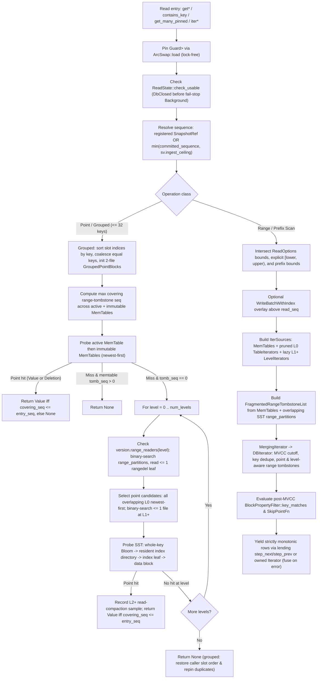
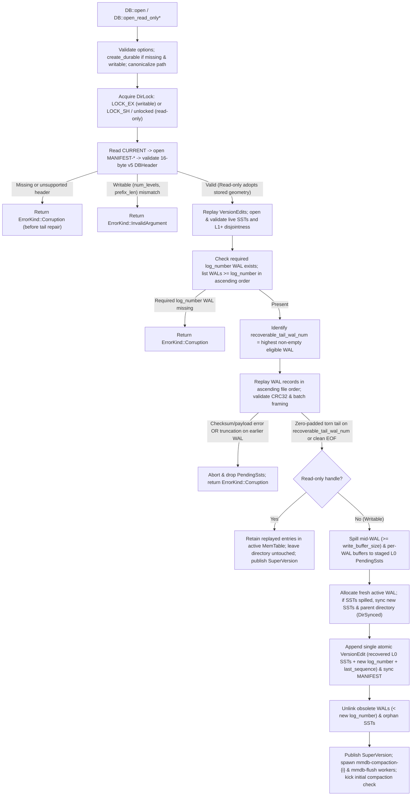
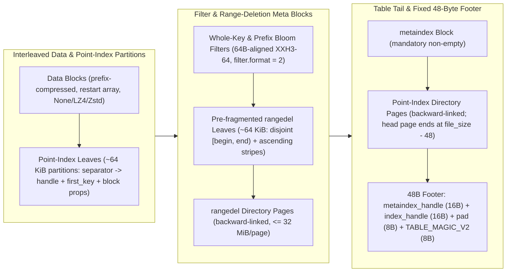
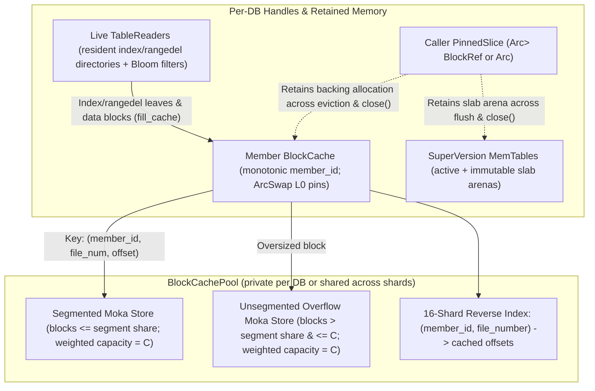
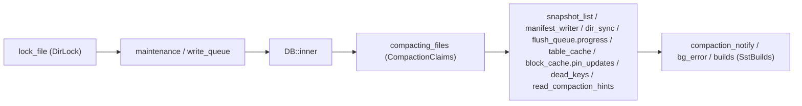

# MMDB v6 storage architecture

MMDB v6 is an in-process embedded Rust LSM-tree key-value engine built as the
local storage backend for [vsdb](https://github.com/rust-util-collections/vsdb).
Each database is a local directory managed inside the caller's process; MMDB
opens no network sockets, runs no external daemon, and enforces no multi-tenant
privilege boundary. Correctness is guaranteed on 64-bit x86 (`x86_64`) and
64-bit ARM (`aarch64`).

For caller-facing operations, see [Using MMDB v6](usage.md). For existing
v5 databases, see [Upgrading to v6](migration.md). Measured workloads and
release decisions are in the [benchmark reports](benchmarks/README.md).

## Global system overview

A writable `DB` handle coordinates foreground writers, lock-free readers, one
FIFO flush worker (`mmdb-flush`), and one or more leveled compaction workers
(`mmdb-compaction-{i}`). Readers acquire a point-in-time `SuperVersion` through
`ArcSwap` without taking the writer mutex, while mutations serialize state
transitions through `WriteQueueState`, `DB::inner`, and `VersionSet`.



### Subsystem map

| Subsystem | Primary modules | Core responsibility |
|-----------|-----------------|---------------------|
| Lifecycle, write group, and maintenance | [`src/db.rs`](../src/db.rs), [`src/db/directory.rs`](../src/db/directory.rs), [`src/options.rs`](../src/options.rs), [`src/error.rs`](../src/error.rs) | Open/recovery, cooperative `LOCK`, admission backpressure, group commit, WAL fences, memtable freeze, explicit maintenance, fail-stop latching, and graceful `close()` |
| FIFO flush pipeline | [`src/db/flush.rs`](../src/db/flush.rs) | Bounded `FlushQueue`, standby WAL pre-allocation, FIFO L0 SST construction, MANIFEST durability confirmation, and old-WAL retirement |
| Sorted bulk ingestion | [`src/db/ingest.rs`](../src/db/ingest.rs) | Disjoint ascending stream directly into bottommost SSTs at one sequence with `ingest_ceiling` isolation for concurrent views |
| Point reads, grouped reads, and snapshots | [`src/db/read.rs`](../src/db/read.rs), [`src/db/snapshot.rs`](../src/db/snapshot.rs), [`src/pinned.rs`](../src/pinned.rs) | Lock-free `SuperVersion` acquisition, scalar and <= 32-key grouped lookups, borrowed `Snapshot` and cloneable `ArcSnapshot` leases, and zero-copy `PinnedSlice` retention |
| Memtable and arena skiplist | [`src/memtable/`](../src/memtable/) | Slab-arena `ConcurrentSkipList`, lock-free Acquire/Release reads, lock-free tiered active range-tombstone index, and per-key metadata budget accounting |
| WAL framing | [`src/wal/`](../src/wal/) | 32 KiB block framing, 7-byte CRC32 fragment headers, vectored `[header, payload]` streaming, advisory Linux writeback, and bounded multi-WAL replay |
| SST v2 tables and Bloom filters | [`src/sst/`](../src/sst/) | Prefix-compressed data blocks, ~64 KiB partitioned index and `rangedel` leaves, backward-linked resident directories, 64B-aligned XXH3-64 blocked Bloom filters, and `TABLE_MAGIC_V2` |
| Merge and bidirectional iterators | [`src/iterator/`](../src/iterator/) | Binary-heap `MergingIterator`, `LevelIterator`, `FragmentedRangeTombstoneList`, MVCC visibility resolution, post-MVCC block-property filtering, and `BidiIterator` |
| Leveled compaction | [`src/compaction/`](../src/compaction/), [`src/rate_limiter.rs`](../src/rate_limiter.rs) | L0 full-set serial merge, L1+ score/min-overlap/range/hint picks, trivial moves, subcompaction range splits, snapshot-aware tombstone stripe GC, and token-bucket write pacing |
| MANIFEST and version set | [`src/manifest/`](../src/manifest/) | `DBHeader` geometry validation, `Version` Copy-on-Write level lists, incremental live-file & neighbor-disjointness install checks, `PendingSsts` RAII orphan cleanup, `DirSynced` + `confirm_manifest_durable` barriers, and `CURRENT` rotation |
| Block and table caches | [`src/cache/`](../src/cache/), [`src/db/memory.rs`](../src/db/memory.rs) | Shared or private `BlockCachePool` (segmented + overflow Moka stores), member-isolated L0 block pins, `TableCache`, and lock-free memory gauges |

## Data model and internal keys

Every stored mutation is keyed by an `InternalKey` composed of the caller's
variable-length `user_key` followed by an 8-byte big-endian inverted trailer:

```text
InternalKey = [ user_key (0..=8 MiB) ][ !(sequence << 8 | value_type) : u64 BE ]
```

- **Sort order.** Bytewise comparison orders entries by `user_key ASC`, then
  `sequence DESC` (up to `MAX_SEQUENCE_NUMBER = (1 << 56) - 1`), and finally
  `value_type DESC` (`RangeDeletion = 2`, `Value = 1`, `Deletion = 0`). Bit
  inversion ensures newer versions sort before older versions in lexicographic
  order.
- **Range deletions.** Half-open `[begin, end)` tombstones are stored separately
  from point entries in active memtables and SST `rangedel` partitions so range
  endpoints do not distort point-key block compression or point bounds, while
  empty or inverted ranges (`begin >= end`) are ignored before memtable insertion
  or rejected if malformed on disk.
- **Write-path size and metadata guards.** Compile-time invariants tie API admission
  limits to the 64 MiB SST decompressed block limit (`MAX_DECOMPRESSED_BLOCK_SIZE`)
  and the 32 MiB SST metadata split threshold (`META_BLOCK_SPLIT_THRESHOLD`):
  - `MAX_USER_KEY_SIZE = 8 MiB` (applies to point keys and both range endpoints).
  - `MAX_WRITE_ENTRY_SIZE = 64 MiB - 72 B` for point `key + value`.
  - `MAX_RANGE_DELETE_SIZE = 32 MiB - 4,168 B` for range `begin + end`.
  - Successive versions of a single user key in one active memtable cannot be
    split across SST files; `admit_same_key_runs` caps each key's metadata
    footprint (`key_or_max_endpoint_len + 40` bytes per version) at `32 MiB`.
  - `admit_range_stripes` caps live distinct snapshot sequences at
    `MAX_RANGE_STRIPES` (`6,290,928`) when admitting a range deletion so an
    elementary interval's sequence array always fits in one `rangedel` leaf.

[InternalKey and batch limits](../src/types.rs) · [SST compile-time bounds](../src/sst/table_builder.rs)

## From a write batch to a durable SST

Foreground writes progress through four decoupled stages: **group commit**,
**memtable freeze**, **FIFO flush**, and **leveled compaction**.



1. **Admission and group commit.** Before entering `write_queue`, nonempty
   batches validate payload bounds and check immutable-queue and L0 backpressure.
   A `no_slowdown` request fails fast with `ErrorKind::Busy` before consuming a
   sequence or writing to the WAL. Among queued requests, one leader drains a
   group up to `min(write_buffer_size / 2, 16 MiB)` (always admitting the head
   batch even if larger). Under `DB::inner`, the leader enforces range-stripe
   and same-key metadata budgets, reserves a contiguous sequence interval, and
   streams one logical WAL record per WAL-enabled batch via `WalWriter::add_record_parts`
   using `[header, payload]` slices without intermediate concatenation. The group
   shares one `wal.flush()` (`WalAsync`), or one `wal.sync_data()` when any
   member requests `WalSync` or `DB::sync_wal()` (`WalFence` with
   `target_seq > synced_wal_seq`). Entries are then inserted into the active
   memtable in sequence order and published atomically via a `Release` store to
   `committed_sequence`.
2. **Post-commit boundary and memtable freeze.** Once `committed_sequence` is
   published, every applied batch in the group is visible and keeps its `Ok(())`
   acknowledgement even if a later batch in the group hit a WAL append error or
   a subsequent automatic freeze fails; the engine latches a fail-stop background
   error for future calls instead of misreporting committed writes as failed.
   Inside the active `ConcurrentSkipList`, point entries occupy bump-allocated
   arena slabs (entries `> 256 KiB` receive dedicated slabs without disturbing
   the active shared slab cursor), and `approximate_size()` accounts for full
   reserved slab bytes plus `MemRangeTombstone` vector capacity, endpoint bytes,
   and range-tombstone index heap (`tombstone_index_bytes`). At 50% of
   `write_buffer_size`, the leader arms asynchronous standby-WAL creation on
   `mmdb-flush`. At 100%, `freeze_memtable` takes `wal_writer` out of `DB::inner`,
   seals the old WAL with `sync_data()` unlocked, installs the zero-length
   standby WAL (or creates a fresh WAL), pushes the frozen memtable to the front
   of `immutable_memtables`, increments `l0_install_epoch`, refreshes
   `SuperVersion`, and submits the generation to `FlushQueue`.
3. **FIFO flush (`mmdb-flush`).** A single dedicated flush worker drains frozen
   generations oldest-first (`pop_front` on `FlushQueue`, corresponding to
   `pop_back` on `immutable_memtables`) so WAL retirement never leapfrogs an
   earlier generation. `DB::flush()` captures the target generation counter and
   waits on `FlushQueue::changed` until `durable >= target`.



[Group commit and freeze](../src/db.rs) · [Flush queue](../src/db/flush.rs) · [Memtable](../src/memtable/)

### Sorted ingestion

`DB::ingest_sorted` streams strictly ascending `(key, value)` pairs directly into
bottommost (`num_levels - 1`) SST files, bypassing the WAL and memtable, and
returns the ingested row count (`Ok(0)` on empty input).

- **Serialization and span disjointness.** Ingestion acquires a `MaintenanceGuard`,
  waits for write-leader exclusivity, and enters `SstBuilds` so re-entrant
  mutations or `close()` from iterator callbacks fail fast with `InvalidArgument`.
  The entire `[min_key, max_key]` user-key span is checked against active and
  immutable memtable entries/tombstones, SST point bounds, and resident
  `range_partition_extents` of every live SST, and revalidated under `DB::inner`
  before MANIFEST installation. Duplicate keys, out-of-order keys, oversized
  entries, or any overlap return `InvalidArgument` while `PendingSsts` unlinks
  uninstalled output files.
- **Single-sequence atomic visibility.** All ingested rows share one fresh
  `ingest_seq`. Under `DB::inner`, the files are installed in one `VersionEdit`
  and protected by a `CompactionClaim` across unlocked `confirm_manifest_durable`
  so concurrent compaction cannot zero their sequences before publication. If
  MANIFEST sync fails after apply, MMDB retains the referenced SSTs and latches
  fail-stop. Once durable, MMDB stores `ingest_seq - 1` into the outgoing view's
  `ingest_ceiling`, allocates a fresh `MAX_SEQUENCE_NUMBER` ceiling for the new
  `SuperVersion`, publishes the new `SuperVersion`, and advances
  `committed_sequence` to `ingest_seq`. Any reader that pinned an earlier
  `SuperVersion` before publication remains capped at `ingest_seq - 1` even if
  later writes advance `committed_sequence`.

[Implementation and race tests](../src/db/ingest.rs)

## Compaction and garbage collection

L0 SSTs are produced by memtable flushes and WAL recovery spills, so their key
ranges may overlap. Levels `L1` through `L(num_levels - 1)` maintain sorted,
strictly disjoint user-key ranges.



- **Picking and extent closure.** Automatic `L0 -> L1` compaction claims the
  entire current L0 set so older overlapping L0 files cannot remain behind newer
  L1 outputs, and executes as a single range to protect foreground read tail
  latency. Deeper levels (`L1+`) pick by byte-budget score, read-sampling hints,
  or explicit `[begin, end)` bounds, expanding source and target inputs over
  resident `TableReader::range_partition_extents()` with zero disk I/O under
  `DB::inner`. Non-L0 jobs can partition merge work into parallel subcompactions
  along sorted `L(n+1)` file boundaries.
- **Snapshots, tombstones, and bottommost GC.** Output file cuts (`pending_cut`)
  defer until the user key changes, and `TableBuilder::clip_at(K_split)` tiles
  crossing range tombstones across `[begin, K_split)` and `[K_split, end)` with
  identical retained sequence stripes and zero gaps. At non-bottommost levels—or
  when an active snapshot requires historical state—point deletions and relevant
  range stripes are preserved. When `is_bottommost_level` confirms zero overlap
  across both point bounds and range-partition extents in all deeper levels:
  - Point `Value` entries older than `oldest_snapshot_seq` have their sequence
    zeroed, and point `Deletion` tombstones below that cutoff are dropped.
  - `RangeFragment::keep_from(oldest_snapshot_seq)` drops range stripes strictly
    `< oldest_snapshot_seq`, matching the strict inequality used for sequence
    zeroing so surviving tombstones never invert visibility against surviving
    points.
- **Compaction filters and lazy deletes.** User `CompactionFilter` callbacks and
  `DB::lazy_delete` / `DB::lazy_delete_batch` registrations (`LazyDeleteFilter`)
  inspect newest visible point values when no active snapshots exist (and drop or
  mutate values once bottommost eligibility is verified). If a snapshot registers
  while an unlocked filter-mutating compaction is in flight, `install_compaction`
  discards the newly built outputs and retries safely. `DeadKeySweepScheduler`
  tracks pending lazy-delete sweeps across background passes and snapshot
  releases, while post-flush and post-compaction pruning removes settled keys in
  bounded chunks off the hot write path.

[Leveled compaction](../src/compaction/leveled.rs) · [Rate limiter](../src/rate_limiter.rs)

## Reading a point and scanning a range

Every read path obeys the **view-before-sequence** barrier: the reader pins a
`Guard<Arc<SuperVersion>>` via `ArcSwap::load` *before* resolving its visibility
sequence. Latest reads load `min(committed_sequence, sv.ingest_ceiling)` with
`Acquire` ordering, pairing with the writer's `Release` store after memtable
insertion. Explicit snapshot reads validate that the supplied `Snapshot` or
`ArcSnapshot` belongs to the target `db_id` (`InvalidArgument` otherwise) and
use its registered sequence. Because `SuperVersion` retains `Arc` references to
the active memtable, immutable memtables, and `Version` (whose `TableFile`s
retain `Arc<TableReader>`s), concurrent flushes, compactions, and cache
evictions never invalidate an in-flight read.



| Read operation | Sources, pruning, and visibility guarantees |
|----------------|---------------------------------------------|
| Scalar point lookup (`get`, `get_pinned`, `contains_key`) | Probes active and immutable memtables newest-first, then levels `0..num_levels`. Because a range tombstone's `end` can extend past a file's `largest_key`, `version.range_readers(level)` is checked independently before resolving point candidates at that level. Point-only levels skip range-reader checks completely. `contains_key` resolves visibility without allocating a value buffer, while `get_pinned` returns a `PinnedSlice` backed by `Arc<MemTable>`, `Arc<Vec<u8>>` (`BlockRef`), or inline empty bytes |
| Grouped point lookup (`get_many_pinned*`) | Captures one `SuperVersion` and one sequence for up to `MAX_GROUPED_READ_KEYS` (32) slots. Sorts slot positions by key, evaluates each distinct key once under identical scalar MVCC rules, and restores caller slot order while `repin()`-cloning duplicate hits. `GroupedPointBlocks` retains a validated index leaf and data block in each of the two most recently probed SSTs so clustered or alternating two-table lookups avoid redundant block cache acquisitions. Any error drops partial pins and records zero returned bytes |
| Forward and reverse scans (`DBIterator`, `BidiIterator`) | Intersects bounds upfront into `IterConfig`. Prefix scans probe SST prefix Bloom filters when `prefix.len() >= prefix_len` to prune point sources while still loading overlapping range tombstones. `TableIterator` checks `iterate_upper_bound` before loading ~64 KiB index leaves. `DBIterator` resolves MVCC sequences, point deletions, and level-scoped range tombstones (a tombstone at level `L` covers only sources at `>= L`) *before* evaluating `BlockPropertyFilter` and `SkipPointFn`. Lending `step_next`/`step_prev` return `Err` immediately on lookahead failure, and every iterator layer latches errors permanently |
| Snapshot handles (`Snapshot`, `ArcSnapshot`) | Registered under `DB::inner` into `SnapshotList` so concurrent compaction cannot collect visible versions. `Snapshot<'a>` borrows `&'a DB`; `ArcSnapshot` shares a `SnapshotLease` holding `Weak<ReadState>`, allowing `DB::close()` to release table readers, caches, and `LOCK` even while cloned `ArcSnapshot`s remain alive (subsequent reads return `DbClosed`) |
| Read-your-writes scan (`iter_with_batch`) | Pins `SuperVersion` and overlays uncommitted `WriteBatchWithIndex` mutations at synthetic sequences `[MAX_SEQUENCE_NUMBER - (ops - 1) ..= MAX_SEQUENCE_NUMBER]` strictly above the captured `read_seq`, hiding concurrent later commits in the active memtable |

[Point lookup and scan setup](../src/db/read.rs) · [Snapshot leases](../src/db/snapshot.rs) · [Merge and visibility](../src/iterator/)

## Database files and recovery

| File | Physical format and role in v6 |
|------|--------------------------------|
| `LOCK` | Cooperative Unix `flock` lock file (`DirLock`). Writable handles acquire `LOCK_EX \| LOCK_NB` before reading metadata; read-only handles acquire `LOCK_SH \| LOCK_NB` if `LOCK` exists, or proceed unlocked on immutable snapshots without `LOCK`. Dropping `DirLock` explicitly issues `LOCK_UN` before closing the descriptor |
| `CURRENT` | ASCII pointer naming the active `MANIFEST-{number}`. Published on creation and MANIFEST rotation via write + `sync_all` on `CURRENT.tmp.{new}`, atomic `rename` to `CURRENT`, and parent directory `sync_all` |
| `MANIFEST-*` | WAL-framed metadata log. Record #0 is the mandatory 16-byte `DBHeader`: `"MMDB"` (4B) + version `5u32` LE + `levels: u32` LE (`2..=16`) + `prefix_len: u32` LE. Subsequent records are incremental `VersionEdit`s recording added/deleted SSTs, `log_number`, `next_file_number`, and `last_sequence` |
| `*.wal` | Write-ahead logs divided into `32 KiB` (`BLOCK_SIZE`) blocks. Records fragment into `Full`, `First`, `Middle`, and `Last` chunks with a 7-byte header: `crc32(type \|\| payload): u32 LE` + `length: u16 LE` + `type: u8`. Each batch payload begins with `first_seq: u64 LE` and `count: u32 LE` |
| `*.sst` | Immutable SST v2 files (`{number:06}.sst`) ending in a 48-byte footer with `TABLE_MAGIC_V2` (`0x4D4D_4442_5353_5402`) |

When creating missing store directories, `directory::create_durable` syncs each
newly created directory entry through its parent directory before descending to
the next path component, then canonicalizes the resolved path for the handle's
lifetime.



Notice two critical recovery invariants:
- **Torn-tail isolation.** An incomplete record followed by zero padding or EOF
  is tolerated *only* on `recoverable_tail_wal_num`—the highest **non-empty**
  eligible WAL. A higher-numbered zero-length standby WAL left behind by an
  interrupted session does not mask a torn record in the actual active WAL, and
  truncation in any earlier WAL fails closed with `ErrorKind::Corruption` so
  prefix recovery never silently drops committed batches.
- **All-or-nothing multi-WAL spill.** Writable recovery can spill bounded L0
  SSTs mid-WAL and at WAL boundaries through `PendingSsts`, but appends no
  `VersionEdit` and deletes no source WAL until *every* eligible WAL validates
  and the single combined recovery edit is durably synced to the MANIFEST.

[Directory creation](../src/db/directory.rs) · [WAL framing](../src/wal/) · [MANIFEST and CURRENT](../src/manifest/version_set.rs) · [Recovery tests](../tests/crash_recovery.rs)

## SST v2 and cache memory

### SST v2 physical layout

Every block inside an SST v2 file is followed by a 5-byte trailer
(`[compression_type: u8][crc32: u32 LE]`, where CRC32 covers the stored payload
plus the compression byte) and is bounded on decompression to `64 MiB`
(`MAX_DECOMPRESSED_BLOCK_SIZE`).



- **Data blocks and shortest separators.** Entries share prefixes within restart
  intervals (`block_restart_interval`, default 16). Between adjacent data blocks,
  `shorten_separator` shortens the index separator only when `lo < prefix < hi`
  strictly as user keys, preserving exact user-key boundaries and an unshortened
  final point key. Both `Value` and `Deletion` user keys feed
  `BlockPropertyCollector`s so point tombstones are never skipped by property
  filters.
- **Paged directories and ~64 KiB leaves.** Point-index leaves and pre-fragmented
  `rangedel` leaves both target `64 KiB` (`PARTITION_BYTES`). Their partition
  directories are serialized as backward-chained, CRC-verified pages targeting
  `32 MiB` (`META_BLOCK_SPLIT_THRESHOLD`), allowing arbitrarily large tables
  without exceeding the 64 MiB block cap. Opening a `TableReader` walks the
  backward chain once (verifying strictly decreasing offsets and footer adjacency),
  restores ascending order in memory, and cross-checks every loaded leaf's start
  and end keys against its resident directory bounds.
- **64-byte blocked Bloom filters.** With `filter.format = 2`, a seed-zero
  XXH3-64 hash selects one 64-byte-aligned cache line (`#[repr(align(64))]`), and
  two mixed 64-bit words supply eight 9-bit probe positions within that line.
  Whole-key filters receive a level-scaled bits-per-key budget (and are omitted
  on newly built bottommost SSTs when `optimize_filters_for_hits` is enabled),
  whereas configured prefix filters (`prefix_len > 0`) retain their base
  bits-per-key budget.

### Cache hierarchy, pins, and memory gauges



- **Pool stores and member isolation.** Every `BlockCache` handle owns a unique,
  never-reused `member_id` inside a private or shared `BlockCachePool`. Cache
  keys include `(member_id, file_number, block_offset)` so distinct DB handles
  never alias bytes. Cached data and index blocks store validated restart
  offsets alongside `Arc<Vec<u8>>` so cache hits skip footer re-validation.
  Blocks heavier than one Moka segment share (up to the configured capacity `C`)
  route to an unsegmented overflow store; because both stores enforce weighted
  capacity `C` independently, the configured value bounds each store rather than
  their sum. Allocations exceeding `u32::MAX` bypass admission and invalidate
  stale keys.
- **L0 pins and `PinnedSlice` lifetimes.** When `pin_l0_first_block_and_warm_index`
  is enabled, flush prepares the first index leaf and first data block of new L0
  SSTs outside `DB::inner`, warms the index leaf in the pool, and publishes the
  data block into the member's lock-free `ArcSwap<PinnedBlocks>` map (range-only
  tables have no data block to pin). Compaction, trivial moves, and `detach()` on
  close unpin retired L0 files and batch-invalidate unpinned entries via the
  16-shard reverse index. A non-empty `PinnedSlice` returned to a caller holds
  its own `Arc<Vec<u8>>` or `Arc<MemTable>` and remains valid across cache
  eviction, flush, and `DB::close()`.
- **Sampling memory.** Different gauges measure distinct ownership domains:
  - `BlockCachePool::usage()` samples the configured byte capacities and
    approximate evictable weighted charges of the segmented and overflow stores
    (which can lag concurrent insertions/evictions until Moka maintenance runs;
    sample once per shared pool).
  - `DB::memory_usage()` acquires `SuperVersion` without locking `DB::inner` to
    report `active_memtable_bytes`, `immutable_memtable_count`, and
    `immutable_memtable_bytes`, plus `l0_pin_bytes` from the member's pin map
    (all zero after `DB::close()`). Flush removes a generation from the reported
    immutable set as soon as its MANIFEST edit is durable, even if a concurrent
    reader still pins that generation.
  - `get_property("block-cache-usage")` returns an approximate **entry count**
    (pool-wide unpinned entries plus this member's L0 pins).
  - Process RSS additionally includes resident `TableReader` directories and
    Bloom filters, retired generations or blocks retained by live iterators and
    `PinnedSlice` handles, and allocator overhead.

[SST builder and reader](../src/sst/) · [Bloom probes](../src/sst/filter.rs) · [Block and table caches](../src/cache/) · [DB memory gauges](../src/db/memory.rs)

## Concurrency, lock hierarchy, and lifecycle

### Lock acquisition order

All mutexes, read-write locks, and condition variables use non-reentrant,
non-poisoning `parking_lot` primitives in a strict acyclic hierarchy:



- **What runs under `DB::inner` vs unlocked.** Group WAL append, WAL flush/sync,
  and ordered memtable insertion run under `DB::inner` (serialization measurements
  showed overlapping WAL and memtable apply projected `< 0.2%` p99 gain while a
  cheaper handoff regressed small-put p99). All heavy SST I/O (`write_memtable_ssts`,
  `execute_compaction_io`, `ingest_sorted` table builds), `TableCache::prewarm`,
  WAL sealing (`old_wal.sync_data()`), directory syncs (`sync_new_sst_parent_dir`),
  and MANIFEST `fsync`s (`confirm_manifest_durable`) execute **outside**
  `DB::inner`.
- **Callback re-entrancy guard (`SstBuilds`).** Every thread executing inside an
  SST build or `ingest_sorted` stream registers in `SstBuilds`. If a user
  `CompactionFilter`, `BlockPropertyCollector`, or ingest iterator attempts to
  mutate or `close()` the same `DB`, `check_writable()` / `close()` immediately
  returns `ErrorKind::InvalidArgument` instead of deadlocking on worker joins or
  mutexes.

### Fail-stop error latching and shutdown

- **Fail-stop publication.** Unrecoverable background flush/compaction errors,
  post-commit WAL append/sync failures, and MANIFEST/directory `fsync` failures
  transition the handle into a fail-stop state (`ErrorKind::Background`) until
  reopen:
  1. `set_bg_error` stores the message in `bg_error` and sets `has_bg_error` with
     `Release` ordering *before* calling `FlushQueue::fail` to wake blocked
     waiters, guaranteeing woken threads observe the latched error on
     `ReadState::check_usable()`.
  2. `sync_new_sst_parent_dir` and `confirm_manifest_durable` serialize
     `(check_poison, fsync, store_poison)` under their respective file locks so
     a later clean `fsync` can never mask an earlier failed durability claim or
     allow premature WAL/SST unlinking.
- **Explicit `DB::close()` vs `Drop`.** Calling `DB::close()` acquires
  `lock_file`, atomically marks `closed = true`, drains active `MaintenanceState`
  operations (`flush`, `compact*`, `ingest_sorted`), waits for any active
  group-commit leader to finish, flushes the final active memtable if healthy
  and writable, joins `mmdb-flush` and all `mmdb-compaction-{i}` threads, detaches
  the member `BlockCache`, snapshots final level/size metrics into
  `ClosedProperties`, closes `TableCache`, releases `DirLock`, and surfaces any
  flush, sync, or background error. Implicit `Drop` performs best-effort WAL
  sync, worker join, cache detach, and unlock when `close()` was not called,
  without discarding existing data.

[Concurrency implementation](../src/db.rs) · [MANIFEST poison gates](../src/manifest/version_set.rs)

## Profiling foreground and background work

- **Per-thread write stages (`bench-metrics`).** Enabling feature `bench-metrics`
  exposes `take_thread_write_profile()`, which drains thread-local counters
  (`ThreadWriteProfile`) for the calling OS thread without atomic contention. A
  group leader accumulates `wal_append_ns`, `wal_flush_ns` / `wal_sync_ns`,
  `apply_ns`, and `freeze_ns` for every batch in its group, whereas followers
  accumulate `queue_wait_ns` overlapping those same leader stages. Compute stage
  shares from leader counters and measure arrival-to-acknowledgement p99
  separately in the caller. Normal builds compile all diagnostic timers to zero
  cost.
- **Per-DB L0 compaction metrics (`bench-metrics`).** `L0CompactionProfile`
  tracks peak installed L0 files, picked L0 input bytes, rewritten output bytes,
  and subcompaction concurrency. Input file lengths measure logical rewrite
  scope rather than physical block-device reads, and trivial moves rewrite zero
  SST bytes.
- **Storage-read and crash-recovery attribution (`test-utils`).** Feature
  `test-utils` exposes `DB::simulate_crash()` (which drops buffered WAL/MANIFEST
  tail bytes without flushing memtables), `point_table_probes()`, and
  `PinnedSlice::sst_backing_charge()` for deterministic durability and
  grouped-read cache/pin attribution tests, plus `concurrent_arena_pins()` under
  Miri.

[Write profiler](../src/profile.rs) · [Engine workloads](benchmarks/engine-profile/README.md) · [L0 experiment](benchmarks/l0-profile/README.md) · [Grouped-read trials](benchmarks/grouped-reads/README.md)
